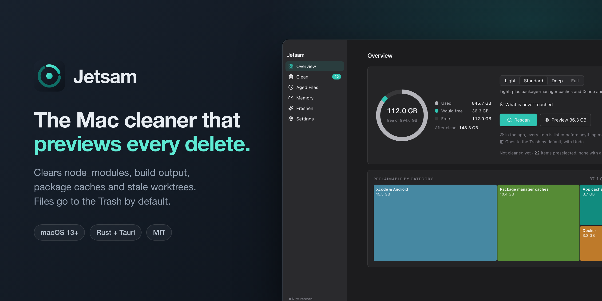
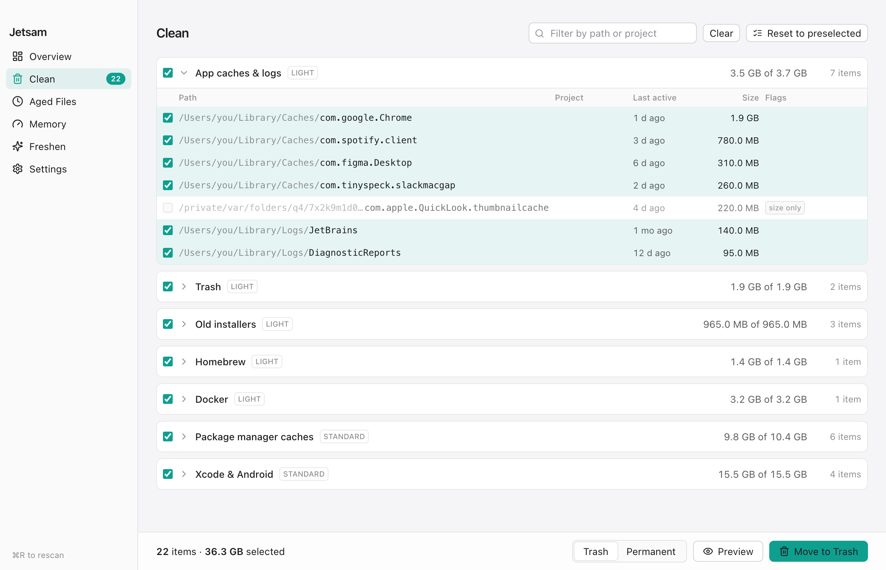
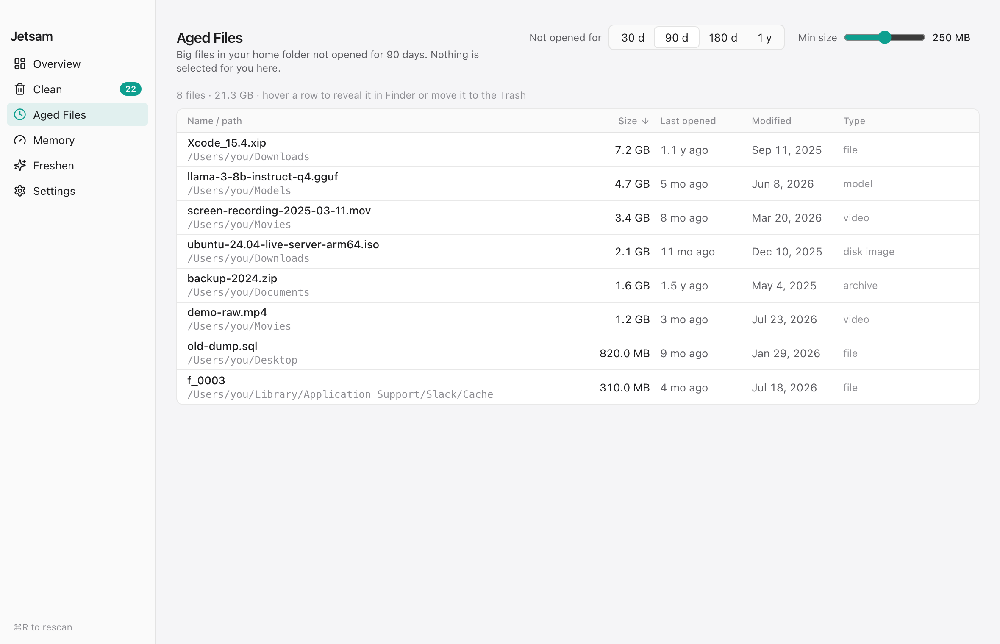
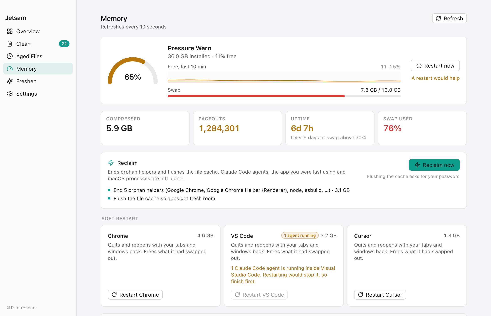

# Jetsam

<a href="https://github.com/nitwit45/jetsam/releases/latest">
  
</a>

Jetsam is a macOS disk and memory cleaner for developers. It removes files your tools can regenerate (node_modules, build output, package caches, stale git worktrees) in four modes from Light to Full. In the app, every path is listed with its size before it can be removed, and files go to the Trash by default. It also lists big files you have not opened in months, and finds memory held by orphaned helpers, leaking processes and headless browsers that coding agents left behind. It never ends a running Claude Code agent or the terminal or editor it runs in.

macOS 13 or later. The DMG is universal, but Jetsam is tested on Apple silicon only: the Intel half has only been run under Rosetta. Version 0.1, not signed or notarized: see [Opening an unsigned build](#opening-an-unsigned-build).

<a href="https://github.com/nitwit45/jetsam/releases/latest">
  <picture>
    <source media="(prefers-color-scheme: dark)" srcset="docs/img/clean-dark.png">
    
  </picture>
</a>

Screenshots show the app's sample data, not a real machine.

## Install

Download [Jetsam.dmg](https://github.com/nitwit45/jetsam/releases/latest/download/Jetsam.dmg), open it and drag Jetsam to Applications. To check it, get `Jetsam.dmg.sha256` from the [release page](https://github.com/nitwit45/jetsam/releases/latest) and run:

```sh
shasum -a 256 -c Jetsam.dmg.sha256
gh release verify-asset Jetsam.dmg --repo nitwit45/jetsam
```

The second command needs [GitHub CLI](https://cli.github.com) 2.81 or later. It checks the file against GitHub's signed record of the release. Releases here are immutable: once one is published, its files and its tag cannot be changed. I built 0.1.0 on my own Mac, not in the release workflow, so it has no build provenance attestation.

Or with Homebrew:

```sh
brew install --cask nitwit45/tap/jetsam
```

The [cask](https://github.com/nitwit45/homebrew-tap/blob/main/Casks/jetsam.rb) removes the quarantine attribute after it installs, which is what the `xattr` command below does by hand, so macOS does not block the first launch.

### Opening an unsigned build

Jetsam is not signed with an Apple Developer ID, so macOS blocks the first launch.

1. Open Jetsam once and close the warning.
2. Open **System Settings > Privacy & Security**, scroll to Security and click **Open Anyway**.

Or in Terminal:

```sh
xattr -dr com.apple.quarantine /Applications/Jetsam.app
```

On macOS 15 and later, Control-click > Open no longer gets past this. If macOS says the app "is damaged and can't be opened", the quarantine flag is the cause and the command above clears it.

Then grant Full Disk Access, see [Permissions and network](#permissions-and-network).

### Updating

Jetsam does not check for updates. To hear about a new version, choose **Watch > Custom > Releases** on this repository. To update, quit Jetsam and replace it in Applications with the one from the new `Jetsam.dmg`, or run `brew upgrade --cask jetsam`. Your settings, the ops log and a weekly clean you had switched on all stay. macOS may ask for Full Disk Access again, because an unsigned build counts as a new app each time: if the banner returns, remove Jetsam from the Full Disk Access list and add it again.

## What it does

### Clean

Pick a mode on **Overview**, press **Scan**, and review the result under **Clean**. Each mode includes the ones above it.

| Mode | Adds |
|---|---|
| Light | `~/Library/Caches` (except what Standard lists) and `~/Library/Logs`, `.dmg` and `.pkg` files in Downloads older than 14 days, Homebrew cleanup, Docker dangling images and build cache. What is already in the Trash is listed too, and is emptied only after you confirm a permanent delete. |
| Standard | Package manager caches (npm, pnpm, bun, pip, cargo, Gradle, Playwright), Xcode and Android leftovers. |
| Deep | Build folders in inactive projects, stale merged worktrees, all unused Docker images, and AI session logs older than 45 days for you to review. |
| Full | Build folders in projects you are working on now. Nothing git-tracked is touched. |

A project is active when its newest commit or git index write is under 14 days old (**Settings > Recent window**). In Deep, an active project's build folders are listed but cannot be ticked; Full lets you tick them. A project outside git has no activity date, so Deep preselects its build folders. Every path and rule: [docs/modes.md](docs/modes.md).

### Aged files

**Aged Files** lists files in your home folder of 250 MB or more that you have not opened in 90 days (adjustable), by Spotlight's last-used date. It walks the whole home folder, `~/Library` and hidden folders included, so a row can be application data or a virtual machine or Docker disk image, and trashing a disk image takes the volumes inside it. Nothing is preselected, and a row's Trash button moves that file at once.

<picture>
  <source media="(prefers-color-scheme: dark)" srcset="docs/img/aged-dark.png">
  
</picture>

### Memory

**Memory** samples every process every 10 seconds and labels it orphan, leak, idle, headless browser, virtual machine or protected. **Reclaim now** ends the orphans, then flushes the file cache. An orphan is a script runtime (`node`, `bun`, `python`, `ruby`, `java`), a JavaScript build tool or an editor helper whose parent exited while Jetsam was open. A job you started with `nohup` and left running after closing its terminal matches, so check the rows labelled orphan before you press it. Other unprotected processes you tick are ended after a confirmation: SIGTERM, then SIGKILL if still running 3 seconds later. Soft restart quits and reopens Chrome, VS Code or Cursor, and refuses while a Claude Code agent runs in the editor. Thresholds are in [docs/memory.md](docs/memory.md).

<picture>
  <source media="(prefers-color-scheme: dark)" srcset="docs/img/memory-dark.png">
  
</picture>

### Freshen

**Freshen** is a screen with four one-off system changes: thin local Time Machine snapshots (permanent), switch the hibernation sleep image, add VS Code watcher excludes, and purge inactive memory. See [docs/freshen.md](docs/freshen.md).

### Schedule and command line

**Settings > Weekly clean** runs a Light or Standard clean every Sunday at 10:00 with no preview. It never empties the Trash. It runs the copy of Jetsam that switched it on, so turn it on from the one in Applications, and its output goes to `~/Library/Logs/Jetsam/weekly.log`. The same run by hand:

```sh
/Applications/Jetsam.app/Contents/MacOS/jetsam --headless --mode standard
/Applications/Jetsam.app/Contents/MacOS/jetsam --headless --mode deep --dry-run
```

`--dry-run` prints totals per category and removes nothing. Deep and Full run headless only with `--dry-run`. An argument Jetsam does not know, a misspelled `--dry-run` included, stops it with exit status 2 before anything runs.

## Safety

Jetsam deletes files and ends processes. The rules below are what limits it.

- In the app, every item is listed with its path and size before it can be removed, and unticking a row keeps it. The weekly job and `--headless` remove what a scan would preselect without asking, and skip anything marked for review.
- Files go to the Trash. When every item in a clean succeeds, the toast offers **Undo** for 12 seconds, which puts back what that clean sent to your home Trash. After that, or after a clean that left items behind, use Finder's **Put Back**. Permanent: the **Permanent** switch, which needs you to type `delete`; `brew cleanup` and the Docker prunes; `git worktree prune` after a worktree is removed; and Freshen's snapshot thinning.
- If the Trash refuses an item, it stays put. A permanent delete is offered behind the same typed confirmation, never run on its own.
- Each path is checked again right before removal and skipped if it changed since the scan.
- Git-tracked files are skipped, even inside a build folder, and a git failure counts as tracked. A folder with `.git` directly inside it is never removed, except a stale worktree.
- `build`, `dist` and similar names count only inside a git repo or next to a project file such as `package.json`. `target` needs a `Cargo.toml` beside it.
- A worktree goes only when it is under `.claude/worktrees/`, has no uncommitted or ignored files other than build output, has no commits outside `main` or `master`, has seen no git activity for 24 hours, and no process works inside it.
- Never touched (the deny-list): Keychains, Mail, Messages, Photos libraries, iCloud Drive, iPhone backups, `~/.ssh`, `~/.gnupg`, `~/.aws`, `~/.kube`, `~/.docker`, Claude Code memory and the system folders. Docker volumes and containers are never pruned. The full list is in [docs/modes.md](docs/modes.md#never-reachable).
- Memory triage never ends a running Claude Code agent, anything it started, the terminal or editor hosting it, the app you were last using and its helpers, Jetsam itself, or [macOS processes](docs/memory.md#protected). Virtual machines are only labelled.
- Every clean is logged to `~/Library/Application Support/Jetsam/ops.log`, one JSON line per item.

Each claim, the code behind it and the test that checks it: [docs/safety.md](docs/safety.md).

## Measured on one machine

I built Jetsam after my MacBook Air (M4, 16 GB RAM, 256 GB SSD, macOS 26.3) ran out of room on 3 Nov 2026. I cleaned it by hand that day, before Jetsam existed, so these numbers are not Jetsam's.

| Before the cleanup | |
|---|---|
| Data volume | 95.5% full, 11 GB free |
| Regenerable build folders under home | 62 GB, 40.2 GB of it in 137 `node_modules` folders |
| Stale git worktrees in one repository | 105 worktrees, 29 GB, plus a 4.3 GB copy inside a `.next` folder |
| Swap | 9.5 GB of 11 GB used, 116 million swap-outs in 6 days of uptime |

Afterwards the volume had 33 GB free. Later, nine headless Chrome instances started by QA scripts under two coding agents held about 5.5 GB resident. One Deep dry run on the same Mac took 22 seconds.

I have not measured the cost side: whatever is removed downloads or rebuilds the next time a project needs it. This is one machine on one day. Method and caveats are in [docs/measurements.md](docs/measurements.md).

## Permissions and network

Without Full Disk Access, macOS stops Jetsam reading some folders in your home folder, the Trash and parts of other apps' data among them. Their items and sizes are missing from a scan, and a banner says so. Granting it does not widen what Jetsam removes. Grant it in **System Settings > Privacy & Security > Full Disk Access**; the banner's button opens that pane.

Jetsam runs as your user. The cache flush, Freshen's purge and the hibernation switch ask for your administrator password each time. **Restart now** opens the macOS restart dialog, which ends every process, running Claude Code agents included, unless you cancel it.

Jetsam makes no network requests. Its code has no HTTP client, and the window's content policy allows connections only to the app itself. Every command it runs is listed in [SECURITY.md](SECURITY.md).

## When not to use Jetsam

- You want a command line tool to script. Use [Mole](https://github.com/tw93/Mole) or [npkill](https://github.com/voidcosmos/npkill).
- You only want to see what fills the disk. GrandPerspective or DaisyDisk do that.
- You need to uninstall apps. Use AppCleaner.
- Your Mac is managed and blocks unsigned apps.
- You are on slow or metered internet. Everything Jetsam removes downloads again the next time you build.

## Uninstall

Turn off **Settings > Weekly clean** first, then quit Jetsam and run:

```sh
rm -rf /Applications/Jetsam.app
rm -rf ~/Library/Application\ Support/Jetsam ~/Library/Logs/Jetsam
rm -rf ~/Library/WebKit/dev.nith.jetsam ~/Library/Caches/dev.nith.jetsam
rm -f ~/Library/LaunchAgents/com.nith.jetsam.weekly.plist
```

Remove Jetsam from **System Settings > Privacy & Security > Full Disk Access**. If you installed with Homebrew, `brew uninstall --zap --cask jetsam` does the same as the commands above.

## Building from source

You need [bun](https://bun.sh) 1.3.13 and a stable Rust toolchain from `rustup`.

```sh
bun install --frozen-lockfile
bun run tauri dev
```

Checks, tests, the DMG build and the sample-data mode are in [docs/building.md](docs/building.md). Jetsam is built on [Tauri](https://tauri.app), [jwalk](https://crates.io/crates/jwalk) for parallel directory walks, [trash](https://crates.io/crates/trash) for the Trash, and [serde](https://serde.rs). To contribute, read [CONTRIBUTING.md](CONTRIBUTING.md) first.

## The name

Jetsam is the memory-pressure mechanism in Apple's XNU kernel. When the system runs short of memory, it terminates processes to get memory back.

## License

MIT, see [LICENSE](LICENSE).
