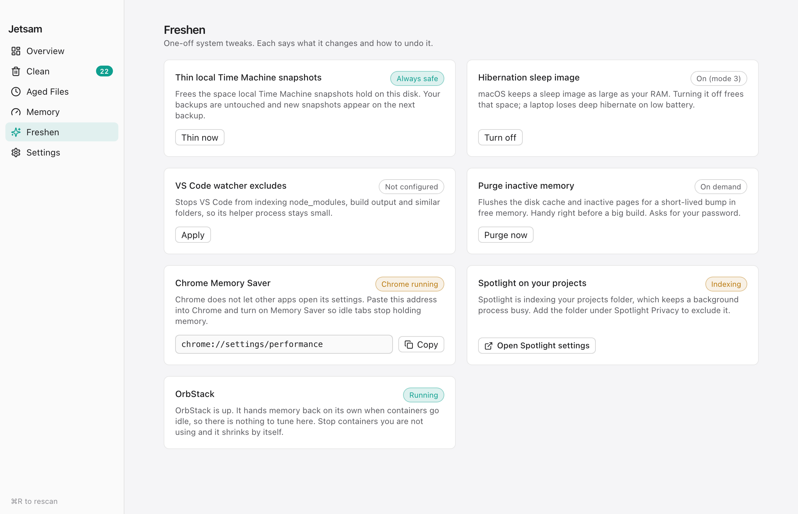

# Freshen

What each card on **Freshen** runs and what it changes. Written from `src-tauri/src/system.rs` and `src/pages/Freshen.tsx`; the code is the reference.

<picture>
  <source media="(prefers-color-scheme: dark)" srcset="img/freshen-dark.png">
  
</picture>

Each card runs once when you press its button. Nothing on this page runs on a schedule.

## Thin local Time Machine snapshots

Runs `tmutil thinlocalsnapshots / 999999999999 4`, which asks macOS to free as much local snapshot space as it can on the startup disk. Thinned snapshots are gone for good and cannot be undone. Backups on your Time Machine disk are not touched. The command runs without a timeout and without the administrator prompt.

## Hibernation sleep image

Shows the current `hibernatemode` from `pmset -g`. **Turn off** runs `pmset -a hibernatemode 0` and **Restore default** runs `pmset -a hibernatemode 3`, each through the macOS administrator prompt. Mode 0 frees the sleep image, which is as large as your RAM, and a laptop then loses its state if the battery runs out while asleep.

## VS Code watcher excludes

Edits `~/Library/Application Support/Code/User/settings.json`:

- adds `**/node_modules/**`, `**/.next/**`, `**/dist/**` and `**/.git/objects/**` with the value `true` to both `files.watcherExclude` and `search.exclude`
- sets `typescript.tsserver.maxTsServerMemory` to 2048, replacing any value you had

Other keys are kept, but the whole file is written back pretty-printed, so its formatting and key order can change. A missing or empty file is created. A file with comments or trailing commas is left alone and the card says "settings.json is not strict JSON (comments or trailing commas); add the excludes by hand". The card shows **Configured** when all four globs are already `true` in `files.watcherExclude`. Only VS Code's settings are touched, not Cursor's.

To undo it, remove those entries in VS Code's settings.

## Purge inactive memory

Runs `purge` through the macOS administrator prompt. It flushes the file cache, so free memory rises for a while and the next reads from disk are slower. Cancelling the prompt skips it.

## Information only

These cards run nothing:

- **Chrome Memory Saver** gives a `chrome://` address to paste into Chrome, because other apps cannot open Chrome's settings.
- **Spotlight indexing** reports whether Spotlight indexing is on for the whole Data volume (`mdutil -s /System/Volumes/Data`) and opens Spotlight settings. It does not check a projects folder, so it still says On after you exclude one, and it says Off when `mdutil` fails.
- **OrbStack** reports whether OrbStack is running.

**Restart now**, on the Memory screen, is in [memory.md](memory.md#restart-now).
