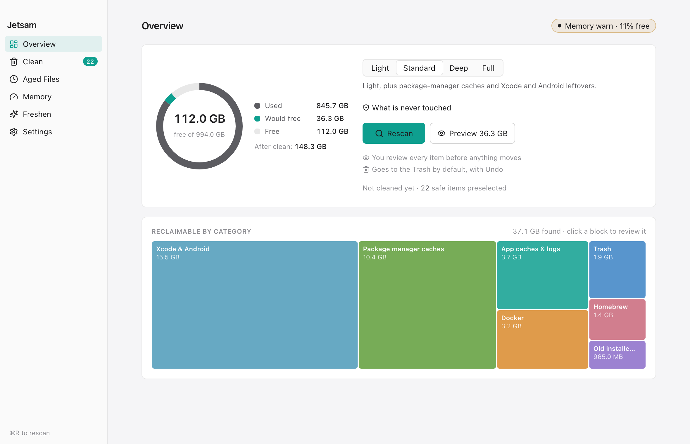
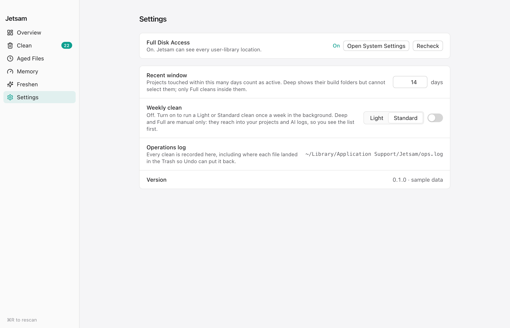

# Modes

Every path and rule each mode uses. Written from `src-tauri/src/rules.rs`, `categories.rs` and `worktrees.rs`; if this page and the code disagree, the code is right and this page is a bug.

Modes are ordered. Each one scans everything the modes above it scan, plus its own categories. `~` is your home folder. You pick the mode on **Overview**, which shows a one-line summary of it.

<picture>
  <source media="(prefers-color-scheme: dark)" srcset="img/overview-dark.png">
  
</picture>

## How an item is marked

A scan lists items. Some carry a flag, shown as a badge in **Clean**:

| Flag | Meaning | Can you tick it? |
|---|---|---|
| `report-only` (shown as "size only") | Listed so you can see the size. Jetsam does not remove it. | No |
| `recent` | In a project or worktree that is active now or within the recent window. | No |
| `git-tracked` (shown as "tracked") | git tracks something inside it, or git could not answer. | No |
| `dirty` | A worktree with uncommitted or ignored files. | No |
| `unmerged` | A worktree with commits not on `main` or `master`. | No |
| `review` | Not regenerable. Selectable, never preselected. | Yes, by hand |

The row's tooltip names the flag as written in the first column, so it says `report-only` and `git-tracked`. A scan preselects every item with none of these flags. Items of zero bytes are dropped from the list. Symlinks are never listed and never followed. `cleaner::verify` refuses the first five again at delete time, whatever the UI sends.

## Light

| Category | What is listed | How it is removed |
|---|---|---|
| App caches & logs | Each entry in `~/Library/Caches`, except `CloudKit`, `com.apple.*` (but `com.apple.helpd` is included) and the `pip`, `ms-playwright` and `com.microsoft.VSCode.ShipIt` caches, which Standard lists under package manager caches. Each entry in `~/Library/Logs`. Each entry in `/private/var/folders/*/*/C`, as `report-only`. | Trash |
| Trash | Each entry in `~/.Trash`. | Permanent only, see below |
| Old installers | Files directly in `~/Downloads` ending in `.dmg` or `.pkg` (any case) last modified more than 14 days ago. Archives such as `.zip` are never included. | Trash |
| Homebrew | One command item when `brew cleanup -n` reports something to free. | Runs `brew cleanup --prune=all -s` |
| Docker | One command item when the active Docker context is a local socket and `docker system df` reports reclaimable images or build cache. | Runs `docker --context <ctx> image prune -f` and `docker --context <ctx> builder prune -af` |

Moving an item that is already in the Trash to the Trash is refused, so items in the Trash category end in the "not cleaned" list with **Delete these permanently** on offer. That step needs you to type `delete`. The exception is a folder in the Trash with a `.git` directly inside, such as a deleted repository: it is refused with "contains a git repository" before the Trash step, gets no permanent delete, and has to be emptied from Finder.

The Docker size is the "Reclaimable" figure `docker system df` gives for images and build cache. Containers and volumes are not counted because they are never pruned.

## Standard

| Category | What is listed | How it is removed |
|---|---|---|
| Package manager caches | `~/.npm/_cacache`, `~/Library/pnpm/store`, `~/.bun/install/cache`, `~/Library/Caches/pip`, `~/.cache/pip`, `~/.cargo/registry/cache`, `~/.gradle/caches`, `~/Library/Caches/ms-playwright`, `~/Library/Caches/com.microsoft.VSCode.ShipIt`. `~/.nuget/packages` as `report-only`. | Trash |
| Xcode & Android | Each entry in `~/Library/Developer/Xcode/DerivedData`. Every folder in `~/Library/Developer/Xcode/iOS DeviceSupport` except the most recently modified one. `~/Library/Developer/CoreSimulator/Caches`. Android virtual devices in `~/.android/avd` not modified for 60 days, as `review`. `~/.gradle/daemon`. | Trash |

## Deep

Deep walks your home folder once. The walk skips folders whose name starts with `.` directly in `~`, skips `~/Library`, skips everything on the deny-list, never follows symlinks and never crosses onto another volume. It stops at each build folder it finds and records each `.git` folder as a repository.

| Category | What is listed | How it is removed |
|---|---|---|
| Docker | As in Light, plus `docker --context <ctx> image prune -af` (all unused images, not only dangling ones). | Command |
| AI session logs | Files not modified for 45 days in `~/.claude/projects` (only `.jsonl`), `~/.codex/sessions`, `~/.cursor/logs` and `~/Library/Application Support/Cursor/logs`. All marked `review`. Claude Code `memory` folders are never read or listed. | Trash |
| Project build artifacts | Build folders found by the walk, see below. | Trash |
| Stale worktrees | Worktrees of the repositories found by the walk, see below. | Trash, then `git worktree prune` in the owning repository, which is permanent |

### Build folders

A folder is a build folder only when its name and its surroundings both match:

| Name | Also needs |
|---|---|
| `node_modules`, `.next`, `.nuxt`, `dist`, `build`, `.turbo`, `__pycache__`, `.venv`, `venv`, `.pytest_cache`, `.gradle`, `coverage`, `.parcel-cache`, `.cache` | A project file beside it, or a git repository above it |
| `target` | A `Cargo.toml` beside it |
| `bin`, `obj` | A `.csproj`, `.fsproj` or `.sln` beside it |

Project files: `package.json`, `pyproject.toml`, `setup.py`, `requirements.txt`, `Cargo.toml`, `go.mod`, `pom.xml`, `Gemfile`, `composer.json`, `Package.swift`, `build.gradle` (and `build.gradle.kts`), and .NET project files.

A folder with a `.git` file or folder directly inside it is never a build folder: it is a repository, a worktree or a submodule.

For a build folder inside a git repository, Jetsam asks git two questions:

- When was the repository last active? The newer of its last commit time and the last write to `.git/index`. If that is less than the recent window ago (14 days by default, 1 to 365 under **Settings > Recent window**), the item is `recent`. If git cannot say, it counts as recent.
- Does git track anything under this folder (`git ls-files`)? If so, or if git fails, the item is `git-tracked`.

A build folder that is not inside any git repository (a project with a `package.json` but no `.git`) has no activity date, so it is listed without the `recent` flag in Deep.

### Worktrees

Only worktrees whose path contains `/.claude/worktrees/` are considered, from `git worktree list --porcelain` in each repository the walk found. The main worktree is never a candidate. Each candidate is listed with these flags when they apply:

- `dirty`: `git status --porcelain --ignored` shows anything other than ignored build output or `.DS_Store`. An ignored path counts as build output when a folder in it passes the build-folder test above, with the worktree counting as the git repository. So an ignored `.env` at the top of the worktree, or an ignored `tools/bin/.env` with no .NET project beside `bin`, makes it dirty. An ignored `scripts/build/local.sh` does not, because `build` inside a repository is a build folder, and it goes to the Trash with the worktree.
- `unmerged`: `git log main..HEAD` (or `master..HEAD`) is not empty, or neither branch exists.
- `recent`: git wrote to the worktree's `HEAD`, `index` or reflog less than 24 hours ago, or a process has its working directory inside it (from `lsof`). If the process list cannot be read, every worktree counts as in use.

At delete time the worktree is checked again for running processes, uncommitted or ignored files, and unmerged commits. The 24-hour check is not repeated.

The recent window does not apply to worktrees. Full mode uses the same worktree rules as Deep.

## Full

Full is Deep with the recent window set to zero, whatever **Settings** says. Build folders in active repositories lose the `recent` flag and can be ticked. Everything else is the same: `git-tracked` items stay locked, the worktree rules do not change, and nothing on the deny-list is reachable.

## Never reachable

These are refused by `rules::is_denied` in every mode, at scan time and again at delete time, including permanent deletes:

- `~/Library/Keychains`, `~/Library/Mail`, `~/Library/Messages`, `~/Library/Mobile Documents` (iCloud Drive), `~/Library/Application Support/MobileSync` (device backups)
- `~/.ssh`, `~/.gnupg`, `~/.aws`, `~/.kube`, `~/.docker`
- `/System`, `/usr`, `/bin`, `/sbin`, `/private/var/db`
- Any path with a `.git` component
- Any path inside a `.photoslibrary`
- `~/.claude/projects/<project>/memory`

These can be scanned beneath but can never be a target themselves: `/`, `/Users`, `/Applications`, `/Library`, `/private`, `/private/var`, `/private/tmp`, `/Volumes`, `~`, `~/Library`, `~/Library/Caches`, `~/Library/Logs`, `~/Library/Application Support`, `~/Library/Developer`, `~/Desktop`, `~/Documents`, `~/Downloads`, `~/Pictures`, `~/Movies`, `~/Music`, `~/.Trash`, `~/.claude`, `~/.claude/projects`, `~/.codex`, `~/.cursor`.

## Commands

A command item can only run `brew` or `docker`. A `docker` command must name the context the scan checked (`--context <name>`) and may only be `image prune` or `builder prune`. Any argument containing `volume`, in any case, refuses the whole item. `container prune` and `system prune` are not allowed, because a stopped container can hold data.

## Headless and scheduled runs

`jetsam --headless --mode <mode>` scans with the default 14-day window and removes every item a scan would preselect, with no preview: no blocking flag and no `review` flag. Files go to the Trash. The Homebrew and Docker command items run too, and those are permanent. Deep and Full are accepted only with `--dry-run`. The weekly job runs the same command in Light or Standard, set under **Settings > Weekly clean**.

`--mode deep` and `--mode=deep` are the same. Any other argument, a misspelled `--dry-run` included, is refused with exit status 2 and nothing runs. `--mode` and `--dry-run` without `--headless` are refused too.

Every headless run, dry runs included, first moves `~/Library/Application Support/fresh` to `~/Library/Application Support/Jetsam` when only the old folder exists, and removes the old `com.fresh.weekly` launchd job.

<picture>
  <source media="(prefers-color-scheme: dark)" srcset="img/settings-dark.png">
  
</picture>
